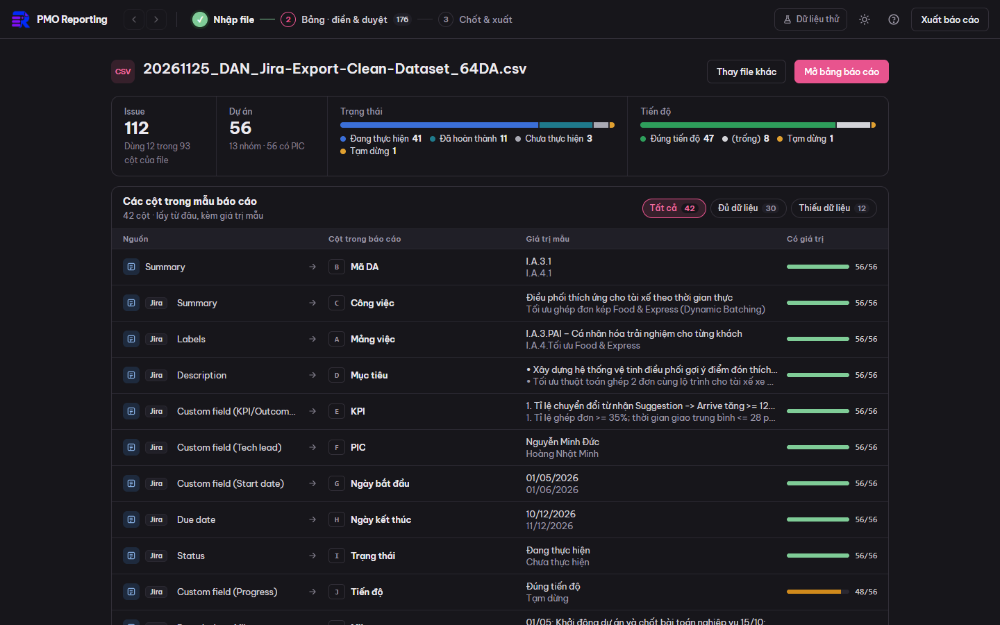
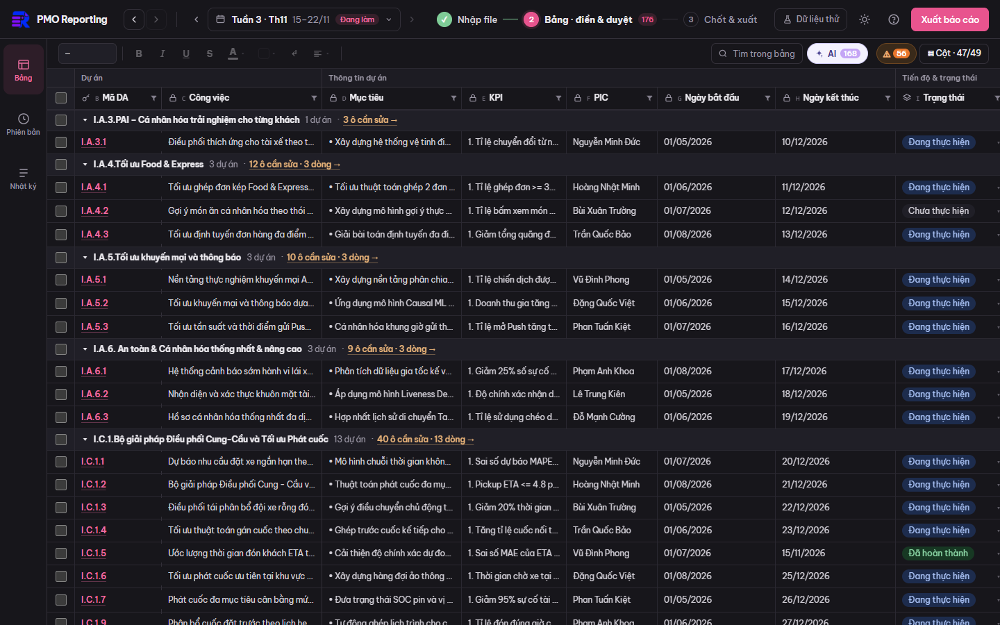
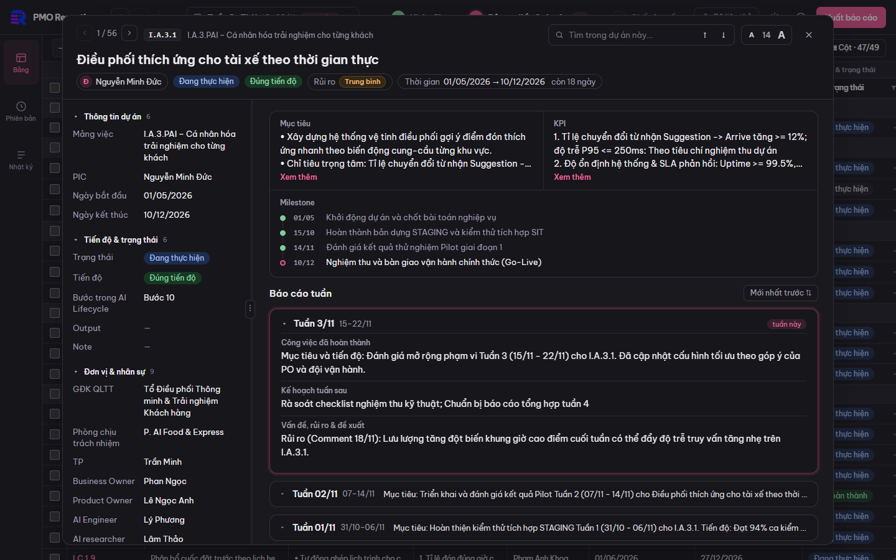
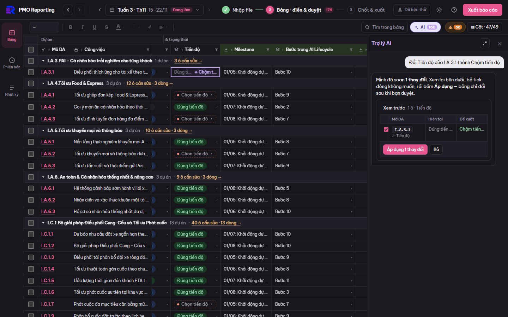
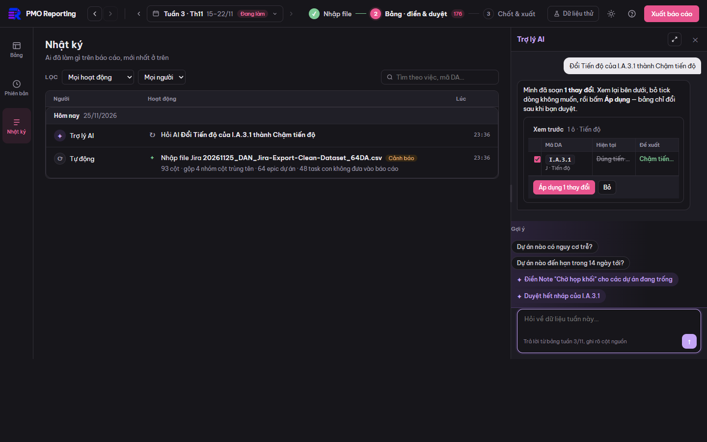

# Client — PMO Reporting (React + Vite + TypeScript)

Giao diện báo cáo PMO tuần: nhập file Jira export, điền & duyệt bảng 49 cột (có Trợ lý AI), chốt phiên bản và xuất Excel 49 cột.
Client được **dựng lại từ đầu** để bám sát "Bản gọn" (`html.lite`) của `docs/superpowers/prototype/PMO Reporting Prototype v4 (Copy).html`.
Chạy hoàn toàn bằng **dữ liệu mock** ở phía client; backend chưa nối.

## Chạy và kiểm thử

```bash
cd client
npm install
npm run dev          # http://localhost:5173
npm test             # vitest, 10 file / 94 test (lần chạy gần nhất theo báo cáo Task 9)
npm run typecheck    # tsc --noEmit
```

## Công nghệ

React 18, TypeScript (strict), Vite 5, zustand + immer (state), vitest (môi trường `node`, không jsdom). Không dùng thư viện UI; một file CSS lấy từ prototype (`src/styles/pmo-prototype.css`). Alias `@` -> `src`. `vite.config.ts` có proxy `/api` -> `localhost:8000` (chưa dùng).

## Luồng sử dụng (3 bước)

1. **Nhập file** — kéo thả / chọn file CSV hoặc Excel (`.csv .tsv .txt .xlsx .xlsm`; `.xls` cũ bị máy chủ từ chối, hãy lưu sang `.xlsx`); xem trước file (`FilePreviewModal`); màn tóm tắt sau khi nạp (issue, dự án, trạng thái, tiến độ, các cột lấy từ Jira).
2. **Bảng · điền & duyệt** — lưới 49 cột, sửa tại ô, bấm 1 lần ở cột có danh sách thì hiện bảng chọn (1-touch picker), lọc/sắp xếp theo cột, tìm, chọn vùng, kéo điền, menu chuột phải, định dạng (đậm/nghiêng/màu/căn lề/wrap), ẩn/hiện/ghim cột, "Duyệt từng ô" cho nháp AI.
3. **Chốt & xuất** — hộp 3 bước (Kiểm tra → Chốt bản vN → Xuất file); chỉ xuất từ bản đã chốt; xuất **Excel 49 cột** (không còn PDF/Word).

Thanh trái (Rail) chỉ có 3 mục: **Bảng**, **Phiên bản**, **Nhật ký**.

Các phần chính khác:
- **Trợ lý AI** (nút ✦ AI): hỏi đáp về số liệu tuần; **Agent** nhận lệnh (vd "Đổi Tiến độ của I.A.3.1 thành Chậm tiến độ"), trả bảng **xem trước**, người dùng tick chọn rồi **Áp dụng** hoặc **Bỏ**; có hoàn tác. Panel "AI soạn ra sao" (`AiTracePanel`) giải thích ô nháp.
- **Project popout** — bấm mã dự án ở cột Mã DA: xem thông tin, milestone, báo cáo từng tuần, tìm trong dự án, đổi cỡ chữ, chuyển dự án.
- **Phiên bản** — danh sách bản đã chốt, so sánh 2 bản, mở lại bản cũ trên bảng.
- **Nhật ký** — ai làm gì trên báo cáo, có lọc theo hoạt động / người / từ khoá.
- **Hướng dẫn** (nút ?) và tour; **đã bỏ** chế độ "Dữ liệu thử" và nút "Dùng dữ liệu mẫu" (toàn bộ dữ liệu giờ từ máy chủ); giao diện sáng/tối; chọn kỳ báo cáo; cấu hình mẫu (số tuần, cột) ở panel bên phải.

## Dữ liệu và localStorage

**Dữ liệu thật từ máy chủ (Giai đoạn 1).** Bảng chỉ được nạp từ API `server/` qua `src/services/api.ts` (proxy Vite `/api` → `http://127.0.0.1:8000`, không dùng `localhost` vì Node 17+ phân giải ra `::1`):

| Việc | API |
|---|---|
| Kỳ báo cáo, ngày báo cáo (`TODAY`, `WEEKS`) | `GET /api/v1/cycles/active` |
| Đọc file Jira (CSV / Excel) | `POST /api/v1/ingest/upload` |
| "Lần nhập gần nhất", nhập lại file cũ | `GET /api/v1/ingest/history`, `GET /api/v1/sessions/{id}` |
| Cấu hình mapping (chọn / lưu mới / cập nhật / nhân bản / đặt mặc định / xoá) | `/api/v1/mappings…` |
| Đổi nguồn một cột Jira (xem trước, chưa lưu) | `POST /api/v1/mapping/recalculate` với `src_overrides` |
| Danh sách bản đã chốt (theo tháng của kỳ đang mở) | `GET /api/v1/reports/versions` |
| Chốt bản bất biến (`doLock`) | `POST /api/v1/reports/lock` |
| Xuất `.xlsx` thật vào file mẫu PMO, tải lại file đã xuất (`doExport`, `reExport`) | `POST` / `GET /api/v1/reports/export-excel` |

**Thông báo lỗi và màn đọc file (sửa giao diện Giai đoạn 1).** Mã lỗi của máy chủ được đổi sang câu tiếng Việt cụ thể bởi `friendlyError` trong `src/services/api.ts` (vd file thiếu cột `Summary` / `Issue key`, định dạng `.xls`, file quá 50 MB, mất kết nối server); mã lạ giữ thông báo gốc. Lỗi nhập file hiện thành khung đỏ cố định ngay trong ô xem trước (`importErr`), file đã chọn được giữ để thử lại; lỗi ở thao tác mapping hiện thông báo nổi 6 giây. Màn **Đang đọc file** làm đúng prototype (`impLoadA`) với số liệu thật: đứng ở bước 1 chờ máy chủ, rồi 4 bước chạy lần lượt mỗi `IMPORT_STEP_MS` = 650 ms, bước xong hiện dòng kết quả ("90 cột, 125 issue", "3 nhóm cột đã gộp", "56 dự án ghép được, 12 issue chưa có mã", "N mã mới" hoặc "Chưa có file tuần trước để so"), cột "Đã tìm thấy" có 6 dòng hiện số dần theo bước (thêm "Mã mới so với tuần trước"), dừng `IMPORT_END_MS` = 400 ms (tổng 3 giây) rồi tự sang màn tóm tắt. Chữ dựng ở `src/lib/importSteps.ts` từ phản hồi `POST /ingest/upload`. Nút "Xem tóm tắt ngay" bỏ qua phần chờ, "Huỷ" giữa chừng thì không nạp bảng; chế độ giảm chuyển động (`prefers-reduced-motion`) không chờ. Tên file dài ở "Lần nhập gần nhất" xuống tối đa 2 dòng (tên đầy đủ ở `title`). Ô chọn cột Jira nằm gọn trong cột "Nguồn". Màn nhập file cuộn được nhờ `body.onimp #root{display:flex;flex-direction:column}` (React gắn vào `#root` trong khi CSS prototype chỉ xếp cột cho `#app`); quy tắc chỉ áp cho màn nhập file. Ảnh chụp mới cần chụp tay: khung lỗi nhập file, màn đọc file có số liệu, bảng mapping có ô chọn cột.

Ở màn **Nhập file** sau khi nạp: thanh **Cấu hình mapping** (`mpBar`) trên bảng 49 cột và ô chọn cột Jira (`mapQuick`) cho 25 cột lấy được từ Jira (`MAPPABLE` trong `ImportView.tsx`); các cột khoá ghép, tính toán, nhập tay/AI và 12 cột tuần giữ nguồn cố định. Đổi nguồn chỉ xem trước (cờ `mpDirty`), bấm "Cập nhật" / "Lưu thành cấu hình mới" mới ghi vào SQLite. `kh` / `vd` (AS, AT) hiện ngay nội dung máy chủ bóc từ Progress Report / Risk Notes bằng quy tắc, chưa có AI (AI là dịch vụ `ai/` riêng, giai đoạn sau); nháp AI nếu có sẽ đè lên.

`src/data/constants.ts` giữ 49 field, hướng dẫn, tour, FAQ... Mã field giữ nguyên theo prototype (`ma`, `rui`, `kh`, `vd`, `tt`...) và là mã dùng chung với `server/`. Dữ liệu dùng trong test nằm riêng ở `src/__tests__/fixtures*` (không vào mã chạy thật).

Khoá localStorage: `pmo-theme`, `pmo-tour-v1`, `pmo-tour-ver`, `pmo-proto-grid-v1` (rộng cột), `pmo-proto-cols-v4` (ẩn cột + ghim), `pmo-proto-panel-v1`, `pmo-proto-imphist-v1` (lịch sử nhập), `pmo-po-fz`, `pmo-po-sidew` (popout).

## Cấu trúc thư mục

```
client/
├─ index.html, vite.config.ts, tsconfig.json
├─ public/logo.png
├─ docs/screenshots/              # ảnh dùng trong README (30–38 là UI hiện tại)
└─ src/
   ├─ main.tsx, App.tsx           # App: ghép Rail/TopBar/panel/lớp nổi, đóng menu khi bấm ra ngoài
   ├─ types/index.ts
   ├─ data/         constants.ts
   ├─ services/     api.ts (máy khách API, ApiError)
   ├─ lib/          hàm thuần: cell, grid, clean, ai, versions, popout, xlsx (ghi .xlsx), theme
   ├─ store/        index.ts (zustand+immer) và actions/ (ai, flow, grid, help, popout, versions)
   ├─ hooks/        useKeyboard, useGridResize
   ├─ components/   layout/ (TopBar, Rail, StatusBar, EditBanner, Toast)
   │                grid/ (Grid, Cell, CellEditor, PickerPop, FillHandle, FormatBar, SelBar, AgentCursor)
   │                layers/ (ContextMenu, FilterPopup, FindCard, PECard, Spotlight)
   │                modals/ (ExportModal, AiDoneModal, HelpDrawer, ProjectPopout)
   │                panels/ (PanelShell, AiAssistantPanel, AiTracePanel, TplConfigPanel), common/
   ├─ views/        Import (+FilePreviewModal), Versions, Log
   ├─ styles/       pmo-prototype.css
   └─ __tests__/    10 file: data, lib-core, store, grid-versions, ai-xlsx, grid-ui, views-shell, panels-modals, app-integration, reset
```

## Màn hình

Ảnh chụp tự động bằng Chrome headless, 1440×900, giao diện tối (theo cài đặt hệ thống lúc chụp), dữ liệu mock.











Các ảnh cũ `01`–`22` trong `docs/screenshots/` là UI trước khi dựng lại (kiểm tra dữ liệu, Điều hành, Rủi ro, Hệ thống, Mẫu BC...), đã lỗi thời và không còn được tham chiếu; chưa xoá để PR chỉ thêm ảnh.

## Những việc đã làm

### Dựng lại client theo prototype v4 "Bản gọn" (nhánh `feat/convert-prototype`)
Kế hoạch: `docs/superpowers/plans/2026-11-25-fe-rebuild-prototype-v4-lite.md`; đặc tả: `docs/superpowers/specs/2026-11-25-fe-rebuild-prototype-v4-lite-design.md`.

**Đã bỏ** (xoá toàn bộ `client/src` cũ, khôi phục được qua git): bước Kiểm tra dữ liệu (check, cleanStats, catalog), màn Điều hành + xuất PDF/Word, màn Rủi ro (bộ tiêu chí), thư viện mẫu báo cáo, màn Hệ thống (danh mục), rổ gom/yêu cầu sửa/ánh xạ cột, đổi tên field sang tiếng Anh, `refine-v2.css`.

**Đã thêm**: luồng 3 bước, Rail 3 mục, lưới 49 cột + picker 1 lần chạm, Trợ lý AI + Agent (xem trước/áp dụng/hoàn tác), project popout, so sánh phiên bản, nhật ký có lọc, hướng dẫn + tour, kịch bản dữ liệu thử, ghi Excel 49 cột (`lib/xlsx.ts`), lưu độ rộng/ẩn cột/ghim vào localStorage. Logic nghiệp vụ nằm ở `lib/*` (hàm thuần, có test) và `store/actions/*`; component chỉ gọi.

**Quyết định cần reviewer biết**
- Prototype HTML là chuẩn khi lệch với plan/test (parity 1:1); mỗi chỗ sửa literal test được ghi trong báo cáo từng task.
- Excel: hàng tiêu đề dùng **một màu nền xám** như hàm xuất của prototype, dù plan/spec ghi "màu theo nhóm". Muốn màu theo nhóm thì là việc nhỏ thêm trong `lib/xlsx.ts`.
- Bộ dòng dùng trong test có 56 dòng dự án (`src/__tests__/fixtures/jira-rows.json`); `loadFixture()` nạp qua đúng hàm production `applyIngest`.
- Giai đoạn 1 kiểm bằng `npm run typecheck` và `npm test` (không chạy `npm run build`).
- Các màn ẩn của prototype (mẫu BC, Điều hành, Rủi ro, Hệ thống...) **cố ý không port**; HELP/TOUR/FAQ đã viết lại theo luồng gọn.
- Picker, filter, menu, find, popout là lớp nổi gắn ngoài `.gridwrap`; `App` đóng menu khi bấm ra ngoài và bỏ qua Esc khi xem trước file toàn màn hình đang mở.
- `main.tsx` chỉ áp theme khi đã lưu `pmo-theme` (giống prototype). Store và component an toàn khi chạy trong node (không có DOM) để test bằng vitest không cần jsdom.
- Không thêm dependency. Giai đoạn 1 có đụng `server/` (hợp đồng `Row`, upload Excel, lịch sử, mở lại phiên, mapping preview) nhưng không đụng `ai/`.
- Màn Phiên bản / Chốt & xuất đã nối máy chủ ở Giai đoạn 3 (xem mục dưới); `versions` không còn lưu ở localStorage.
- Ảnh chụp màn hình mới của bước 1 (mpBar, mapQuick) cần chụp tay khi chạy `npm run dev` cùng `server/`; chưa có trong `docs/screenshots/`.

### Giai đoạn 3 — chốt bản bất biến, xuất Excel thật, tuần động w1..w4 (nhánh `feat/backend-integrate`)
Kế hoạch: `docs/superpowers/plans/2026-11-26-stage-3-versions-export-and-cycles.md`; đặc tả: `docs/superpowers/specs/2026-11-26-stage-3-versions-export-and-cycles-design.md`. **Không đổi giao diện** (không sửa JSX bố cục, CSS, nút, cột); không đụng `ai/`, `lib/ai.ts`, `actions/ai.ts`; không thêm endpoint chuyển kỳ (`GET /cycles/active` vẫn tự chạy theo ngày thật).
- **Bản đã chốt nằm trên máy chủ** (bảng `report_versions`): `doLock` gửi `snap`, `raw_notes` (Note gốc, chưa ghép hậu tố "sửa tay"), `fmt`/`wrap` (khoá đổi `chỉ số dòng|cột` → `mã|cột`), `hidden`, `edits`; `vKey` `wk|v` được tách theo tháng của kỳ. `verOpen` ("Mở →" ở bước 1) tự nạp phiên (`getSession`) khi bảng chưa nạp, khôi phục `snap` + định dạng + cột ẩn, đặt `editWk` nếu bản không thuộc tuần đang làm, và bọc trong `withSuppressedDraftSync` nên không ghi đè nháp của phiên đó cho tới khi người dùng thực sự sửa.
- **Xuất Excel thật**: `doExport` gọi `POST /reports/export-excel`, máy chủ điền vào file mẫu PMO bằng `openpyxl` (giữ nguyên sheet, hàng tiêu đề, định dạng gốc) rồi trả `.xlsx`; `reExport` tải đúng file đã xuất. Hai ô trong "Tuỳ chọn ghi file" nay có tác dụng: *Chỉ ghi khối tuần đang chốt* (mặc định bật: chỉ ghi đè 3 cột của khối tuần đó, 3 khối còn lại trên mẫu giữ nguyên; tắt: ghi đè cả 4 khối `AL..AW`) và *Ghi ô đã sửa tay vào Note* (tắt: ghi Note gốc không có hậu tố). "Cột đang hiển thị" ẩn các cột ẩn bằng `column_dimensions.hidden` (không xoá cột, giữ đủ 49 cột).
- **Tuần động** (Phương án 1A): `lib/cell.ts` có `activeWkOf(s?)` và `effectiveKind(f, s?)`; tuần `cur` sửa được (kể cả `w4` ở kỳ `2026_11_w4`), tuần `future` hiện `—`, tuần đã qua là `past` và khoá. Đọc `s.weeks`, không có thì đọc `WEEKS` toàn cục (do `setCycle` cập nhật), không có nữa thì dùng `f.kind` như trước. Nhãn "Tuần 3/11", tên file mặc định, khoảng cột `AR–AT`, "Cấu hình mẫu" (số tuần, khối tuần sau), Popout, thanh trên đều lấy theo kỳ.
- `rule_engine.py` `prw` hỗ trợ tuần 1..4. `server/storage/exports/` chứa các file đã xuất (không đưa vào git); đổi thư mục bằng biến môi trường `EXPORTS_DIR`.
- Kiểm: `python -m pytest server/tests/ -v` và `npm --prefix client run typecheck && npm --prefix client test` (không chạy `npm run build`). Giao diện không đổi nên không có ảnh màn hình mới.
- Còn lại: `exXlsx` / `xlsxName` trong `lib/xlsx.ts` không còn được gọi (vẫn có test), có thể xoá khi dọn dẹp.

## Trạng thái và hạn chế đã biết
- Mọi dữ liệu là mock. Nạp file là giả lập (chưa gửi backend).
- **Chưa có kiểm thử tự động trên trình duyệt thật**: test chạy trong node, không phủ click ngoài/hiệu ứng/kéo thả. Lần chụp ảnh ở trên chỉ là chạy thử một lượt, không báo lỗi console. Danh sách người kiểm tay:
  - kéo-thả/đổi cỡ: panel (`.pnrz`), chia đôi popout (`.pa-split`), độ rộng cột, kéo chọn vùng;
  - Spotlight của tour: vị trí lỗ sáng và khung hình đầu bị nháy; tour tự mở lần đầu (bản `all` một lần);
  - đọc file `.xlsx` thật bằng `pvReadXlsx`;
  - Ctrl + cuộn để phóng to bảng;
  - bấm ra ngoài thì menu đóng trên trình duyệt thật;
  - hiệu ứng `body.vchg` so với các lớp `position:fixed`;
  - tự cuộn của panel AI.
- Lỗi nhỏ đã biết: Esc khi đang gõ ở ô `.fxval` vẫn đóng find/filter/menu.
- Quan sát khi chụp ảnh: sau khi Agent soạn thay đổi ở cột Tiến độ, bảng cuộn ngang và phần ghim cột Công việc trông lệch vài chục px so với tiêu đề; ở màn Nhật ký, panel AI và khung nội dung kết thúc trước đáy cửa sổ (dải trống). Chưa điều tra nguyên nhân.

## Quy ước làm việc (cho PR)
- Mỗi thay đổi kèm cập nhật tài liệu: mục "Những việc đã làm" trong README này (hoặc file trong `docs/`), và chụp lại ảnh màn hình nếu giao diện đổi.
- Tên biến/hàm/field bằng tiếng Anh; chuỗi hiển thị cho người dùng giữ tiếng Việt. (Riêng mã field dữ liệu như `ma`, `rui` được giữ nguyên theo prototype ở bản dựng lại này.)
