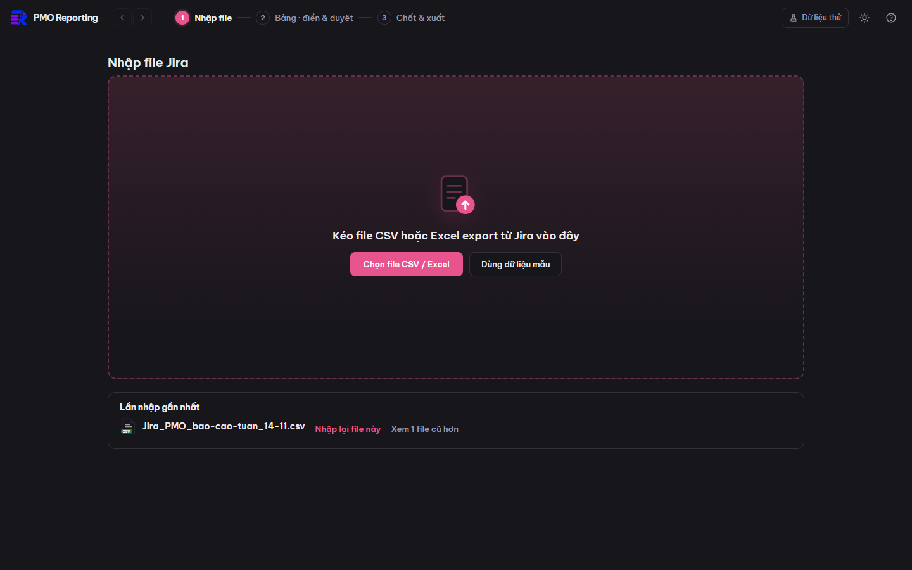
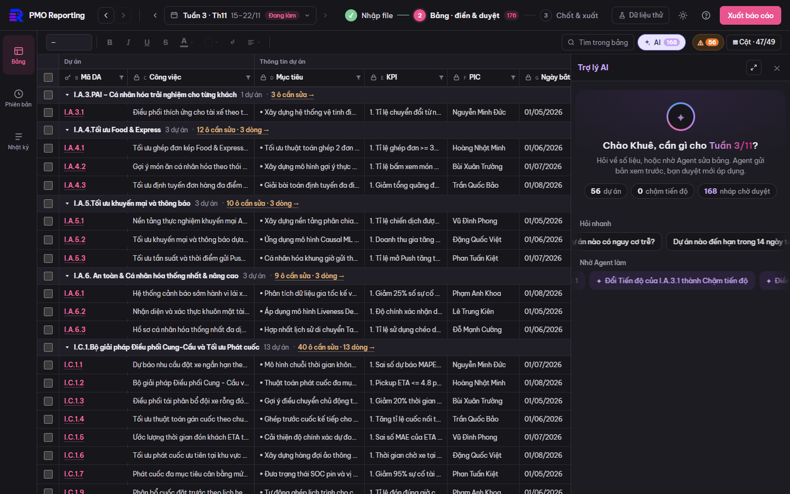
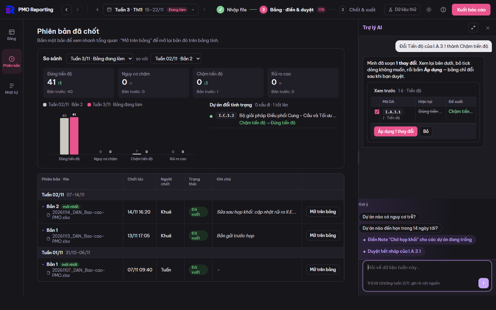
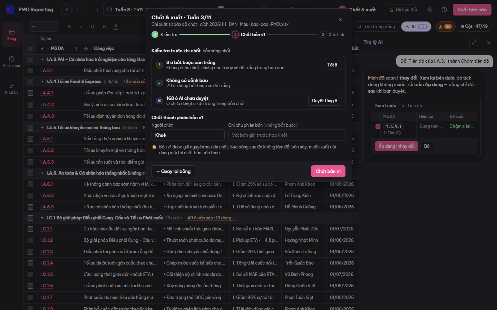

# Client — PMO Reporting (React + Vite + TypeScript)

Giao diện báo cáo PMO tuần: nhập file Jira export, điền & duyệt bảng 49 cột (có Trợ lý AI), chốt phiên bản và xuất Excel 49 cột.
Client được **dựng lại từ đầu** để bám sát "Bản gọn" (`html.lite`) của `docs/superpowers/prototype/PMO Reporting Prototype v4 (Copy).html`.
Chạy hoàn toàn bằng **dữ liệu mock** ở phía client; backend chưa nối.

## Chạy và kiểm thử

```bash
cd client
npm install
npm run dev          # http://localhost:5173
npm test             # vitest, 10 file / 94 test (lần chạy gần nhất theo báo cáo Task 9)
npm run typecheck    # tsc --noEmit
```

## Công nghệ

React 18, TypeScript (strict), Vite 5, zustand + immer (state), vitest (môi trường `node`, không jsdom). Không dùng thư viện UI; một file CSS lấy từ prototype (`src/styles/pmo-prototype.css`). Alias `@` -> `src`. `vite.config.ts` có proxy `/api` -> `localhost:8000` (chưa dùng).

## Luồng sử dụng (3 bước)

1. **Nhập file** — kéo thả / chọn file CSV, Excel, hoặc "Dùng dữ liệu mẫu"; xem trước file (`FilePreviewModal`); màn tóm tắt sau khi nạp (issue, dự án, trạng thái, tiến độ, các cột lấy từ Jira).
2. **Bảng · điền & duyệt** — lưới 49 cột, sửa tại ô, bấm 1 lần ở cột có danh sách thì hiện bảng chọn (1-touch picker), lọc/sắp xếp theo cột, tìm, chọn vùng, kéo điền, menu chuột phải, định dạng (đậm/nghiêng/màu/căn lề/wrap), ẩn/hiện/ghim cột, "Duyệt từng ô" cho nháp AI.
3. **Chốt & xuất** — hộp 3 bước (Kiểm tra → Chốt bản vN → Xuất file); chỉ xuất từ bản đã chốt; xuất **Excel 49 cột** (không còn PDF/Word).

Thanh trái (Rail) chỉ có 3 mục: **Bảng**, **Phiên bản**, **Nhật ký**.

Các phần chính khác:
- **Trợ lý AI** (nút ✦ AI): hỏi đáp về số liệu tuần; **Agent** nhận lệnh (vd "Đổi Tiến độ của I.A.3.1 thành Chậm tiến độ"), trả bảng **xem trước**, người dùng tick chọn rồi **Áp dụng** hoặc **Bỏ**; có hoàn tác. Panel "AI soạn ra sao" (`AiTracePanel`) giải thích ô nháp.
- **Project popout** — bấm mã dự án ở cột Mã DA: xem thông tin, milestone, báo cáo từng tuần, tìm trong dự án, đổi cỡ chữ, chuyển dự án.
- **Phiên bản** — danh sách bản đã chốt, so sánh 2 bản, mở lại bản cũ trên bảng.
- **Nhật ký** — ai làm gì trên báo cáo, có lọc theo hoạt động / người / từ khoá.
- **Hướng dẫn** (nút ?) và tour; **Dữ liệu thử** (kịch bản test, thoát thì khôi phục nguyên trạng); giao diện sáng/tối; chọn kỳ báo cáo; cấu hình mẫu (số tuần, cột) ở panel bên phải.

## Dữ liệu và localStorage

Mock ở `src/data/demo.json` + `src/data/constants.ts` (49 field, hướng dẫn, tour, FAQ...). Dữ liệu mẫu "GOLD" có **56 dòng dự án** (`stats.epics` = 64 là số epic trong file Jira gốc). Mã field giữ nguyên theo prototype (`ma`, `rui`, `kh`, `vd`, `tt`...), không đổi sang tiếng Anh.

Khoá localStorage: `pmo-theme`, `pmo-tour-v1`, `pmo-tour-ver`, `pmo-proto-store-v1`, `pmo-proto-grid-v1` (rộng cột), `pmo-proto-cols-v4` (ẩn cột + ghim), `pmo-proto-panel-v1`, `pmo-proto-imphist-v1` (lịch sử nhập), `pmo-po-fz`, `pmo-po-sidew` (popout).

## Cấu trúc thư mục

```
client/
├─ index.html, vite.config.ts, tsconfig.json
├─ public/logo.png
├─ docs/screenshots/              # ảnh dùng trong README (30–38 là UI hiện tại)
└─ src/
   ├─ main.tsx, App.tsx           # App: ghép Rail/TopBar/panel/lớp nổi, đóng menu khi bấm ra ngoài
   ├─ types/index.ts
   ├─ data/         demo.json, constants.ts
   ├─ lib/          hàm thuần: cell, grid, clean, ai, versions, popout, xlsx (ghi .xlsx), theme
   ├─ store/        index.ts (zustand+immer) và actions/ (ai, flow, grid, help, popout, versions)
   ├─ hooks/        useKeyboard, useGridResize
   ├─ components/   layout/ (TopBar, Rail, StatusBar, EditBanner, TestBanner, Toast)
   │                grid/ (Grid, Cell, CellEditor, PickerPop, FillHandle, FormatBar, SelBar, AgentCursor)
   │                layers/ (ContextMenu, FilterPopup, FindCard, PECard, Spotlight)
   │                modals/ (ExportModal, AiDoneModal, HelpDrawer, ProjectPopout)
   │                panels/ (PanelShell, AiAssistantPanel, AiTracePanel, TplConfigPanel), common/
   ├─ views/        Import (+FilePreviewModal), Versions, Log
   ├─ styles/       pmo-prototype.css
   └─ __tests__/    10 file: data, lib-core, store, grid-versions, ai-xlsx, grid-ui, views-shell, panels-modals, app-integration, reset
```

## Màn hình

Ảnh chụp tự động bằng Chrome headless, 1440×900, giao diện tối (theo cài đặt hệ thống lúc chụp), dữ liệu mock.










Các ảnh cũ `01`–`22` trong `docs/screenshots/` là UI trước khi dựng lại (kiểm tra dữ liệu, Điều hành, Rủi ro, Hệ thống, Mẫu BC...), đã lỗi thời và không còn được tham chiếu; chưa xoá để PR chỉ thêm ảnh.

## Những việc đã làm

### Dựng lại client theo prototype v4 "Bản gọn" (nhánh `feat/convert-prototype`)
Kế hoạch: `docs/superpowers/plans/2026-11-25-fe-rebuild-prototype-v4-lite.md`; đặc tả: `docs/superpowers/specs/2026-11-25-fe-rebuild-prototype-v4-lite-design.md`.

**Đã bỏ** (xoá toàn bộ `client/src` cũ, khôi phục được qua git): bước Kiểm tra dữ liệu (check, cleanStats, catalog), màn Điều hành + xuất PDF/Word, màn Rủi ro (bộ tiêu chí), thư viện mẫu báo cáo, màn Hệ thống (danh mục), rổ gom/yêu cầu sửa/ánh xạ cột, đổi tên field sang tiếng Anh, `refine-v2.css`.

**Đã thêm**: luồng 3 bước, Rail 3 mục, lưới 49 cột + picker 1 lần chạm, Trợ lý AI + Agent (xem trước/áp dụng/hoàn tác), project popout, so sánh phiên bản, nhật ký có lọc, hướng dẫn + tour, kịch bản dữ liệu thử, ghi Excel 49 cột (`lib/xlsx.ts`), lưu độ rộng/ẩn cột/ghim vào localStorage. Logic nghiệp vụ nằm ở `lib/*` (hàm thuần, có test) và `store/actions/*`; component chỉ gọi.

**Quyết định cần reviewer biết**
- Prototype HTML là chuẩn khi lệch với plan/test (parity 1:1); mỗi chỗ sửa literal test được ghi trong báo cáo từng task.
- Excel: hàng tiêu đề dùng **một màu nền xám** như hàm xuất của prototype, dù plan/spec ghi "màu theo nhóm". Muốn màu theo nhóm thì là việc nhỏ thêm trong `lib/xlsx.ts`.
- Dữ liệu GOLD có 56 dòng dự án (không phải 64); test dùng số thật của prototype.
- Thoát chế độ "Dữ liệu thử" khôi phục đúng ảnh chụp trước khi vào (prototype chỉ reset rồi áp lại nên mất sửa tay).
- Các màn ẩn của prototype (mẫu BC, Điều hành, Rủi ro, Hệ thống...) **cố ý không port**; HELP/TOUR/FAQ đã viết lại theo luồng gọn.
- Picker, filter, menu, find, popout là lớp nổi gắn ngoài `.gridwrap`; `App` đóng menu khi bấm ra ngoài và bỏ qua Esc khi xem trước file toàn màn hình đang mở.
- `main.tsx` chỉ áp theme khi đã lưu `pmo-theme` (giống prototype). Store và component an toàn khi chạy trong node (không có DOM) để test bằng vitest không cần jsdom.
- Không thêm dependency; không đụng `server/`.

## Trạng thái và hạn chế đã biết
- Mọi dữ liệu là mock. Nạp file là giả lập (chưa gửi backend).
- **Chưa có kiểm thử tự động trên trình duyệt thật**: test chạy trong node, không phủ click ngoài/hiệu ứng/kéo thả. Lần chụp ảnh ở trên chỉ là chạy thử một lượt, không báo lỗi console. Danh sách người kiểm tay:
  - kéo-thả/đổi cỡ: panel (`.pnrz`), chia đôi popout (`.pa-split`), độ rộng cột, kéo chọn vùng;
  - Spotlight của tour: vị trí lỗ sáng và khung hình đầu bị nháy; tour tự mở lần đầu (bản `all` một lần);
  - đọc file `.xlsx` thật bằng `pvReadXlsx`;
  - Ctrl + cuộn để phóng to bảng;
  - bấm ra ngoài thì menu đóng trên trình duyệt thật;
  - hiệu ứng `body.vchg` so với các lớp `position:fixed`;
  - tự cuộn của panel AI.
- Lỗi nhỏ đã biết: Esc khi đang gõ ở ô `.fxval` vẫn đóng find/filter/menu.
- Quan sát khi chụp ảnh: sau khi Agent soạn thay đổi ở cột Tiến độ, bảng cuộn ngang và phần ghim cột Công việc trông lệch vài chục px so với tiêu đề; ở màn Nhật ký, panel AI và khung nội dung kết thúc trước đáy cửa sổ (dải trống). Chưa điều tra nguyên nhân.

## Quy ước làm việc (cho PR)
- Mỗi thay đổi kèm cập nhật tài liệu: mục "Những việc đã làm" trong README này (hoặc file trong `docs/`), và chụp lại ảnh màn hình nếu giao diện đổi.
- Tên biến/hàm/field bằng tiếng Anh; chuỗi hiển thị cho người dùng giữ tiếng Việt. (Riêng mã field dữ liệu như `ma`, `rui` được giữ nguyên theo prototype ở bản dựng lại này.)
