# Client — PMO Reporting (React + Vite + TypeScript)

Giao diện báo cáo PMO: nhập file Jira, kiểm tra dữ liệu, điền & duyệt (có AI soạn nháp), chốt phiên bản và xuất báo cáo PDF/Word.
Đây là bản port từ prototype HTML một file sang React. Hiện chạy hoàn toàn bằng **dữ liệu mock** ở phía client; backend chưa nối.

## Chạy

```bash
cd client
npm install
npm run dev        # http://localhost:5173  (proxy /api -> http://localhost:8000)
npm run typecheck  # tsc --noEmit
npm test           # vitest: smoke render mọi view + luồng nghiệp vụ
npm run build      # typecheck + vite build
```

## Công nghệ

React 18, TypeScript (strict), Vite 5, zustand + immer (state), vitest. Không dùng thư viện UI; CSS thuần, class dùng chung.

## Cấu trúc thư mục

```
client/
├─ index.html, vite.config.ts, tsconfig.json   # alias "@" -> src
├─ docs/screenshots/                           # ảnh dùng trong README này
└─ src/
   ├─ main.tsx, App.tsx
   ├─ types/        kiểu dùng chung (Row, Field, Catalog, ...)
   ├─ data/         mock: demo.json, constants.ts, seed.ts, tour.ts
   ├─ lib/          hàm thuần (cell, check, selectors, exec, grid, export/docx|pdf|docHtml)
   ├─ store/        zustand: types.ts (AppState), index.ts, actions/ (flow, grid, catalog, exportReport)
   ├─ hooks/        useDerived, useGridKeyboard, useColResize
   ├─ components/   layout/ grid/ panels/ modals/ layers/ common/
   ├─ views/        Import, Check, Template, Exec, Catalog, Versions, Log
   ├─ styles/       *.css (global, giữ class gốc của prototype)
   └─ __tests__/    smoke + flows
```

## Những việc đã làm

### 1. Tổ chức lại repo
- Chuyển toàn bộ code giao diện vào `client/` (trước nằm ở `src/`). Alias `@` trỏ `client/src`.
- Tách `client/` và `server/` độc lập, mỗi bên có `package.json`/`node_modules` riêng (server dự kiến Python). Không dùng npm workspaces.
- Thêm proxy `/api` -> `localhost:8000` trong `vite.config.ts` để gọi backend lúc dev mà không dính CORS.

### 2. Chuẩn convention: đổi tên field sang tiếng Anh
Toàn bộ field id / biến tiếng Việt không dấu được đổi sang tiếng Anh (cột Excel `col` giữ nguyên). Kiểm chứng bằng cách so snapshot dữ liệu seed trước/sau khi đổi: giống hệt (sau khi map khoá).

| Cũ | Mới | Cũ | Mới |
|---|---|---|---|
| `ma` | `code` | `giatri` | `businessValue` |
| `viec` | `task` | `rui` | `riskLevel` |
| `mang` | `workstream` | `loai` | `projectType` |
| `muctieu` | `objective` | `buoc` | `lifecycleStep` |
| `tt` | `status` | `buocso` | `lifecycleStepNo` |
| `td` | `progress` | `uoctinh` | `valueEstimate` |
| `gdk` | `divisionHead` (GĐK QLTT) | `nextstep` | `nextStep` |
| `phong` | `department` | `aieng` / `airs` | `aiEngineer` / `aiResearcher` |
| `tp` | `deptHead` (Trưởng phòng) | `mlops` / `swe` | `mlopsEngineer` / `softwareEngineer` |
| `bo` | `businessOwner` | `tt1` | `statusAlt` (cột AA, "TRẠNG THÁI 1") |
| `caitien` | `initiativeType` | `w{1,2,4}{ht,kh,vd}` | `w{n}{Done,Plan,Issues}` |
| `ht` / `kh` / `vd` (tuần 3) | `w3Done` / `w3Plan` / `w3Issues` | `kq` / `cd` | `kpiResult` / `directive` |

Đổi tên khác: `pinViec`→`pinTask`, `exTT`→`exStatus`, `vdReal`→`hasIssues`, `MAN3`→`LEVELS`, `PHONG_OF`→`DEPARTMENT_OF`.
Tên `divisionHead`, `deptHead`, `statusAlt` là suy đoán từ nhãn cột — cần team xác nhận.
Class CSS (`.ma`, `.cd`, `.tt`...) giữ nguyên, chưa đổi.

**Lưu ý tương thích:** khoá localStorage đã tăng phiên bản (`pmo-sys-v3`, `pmo-proto-cfg-v2`, `pmo-proto-cols-v5`) vì dữ liệu lưu cũ dùng id cũ; cấu hình đã lưu trước đó sẽ bị bỏ.

### 3. Sửa lỗi cấu hình
- Thêm `src/vite-env.d.ts` (`/// <reference types="vite/client" />`) để import `.css` không báo lỗi "Cannot find module".
- Bỏ `baseUrl` và `ignoreDeprecations` khỏi `tsconfig.json` (giá trị `"6.0"` không hợp lệ với TS 5.9). `paths` dùng `./src/*`.

## Màn hình

Ảnh chụp ở 1440×900, dữ liệu mock sau khi bấm "Dùng dữ liệu mẫu".

### Bước 1 · Nhập file
Kéo thả hoặc chọn CSV Jira. Hiện tại chỉ giả lập đọc file (chưa gửi backend).


Sau khi nạp: tóm tắt thay đổi so với tuần trước và việc còn lại ở bước Kiểm tra.

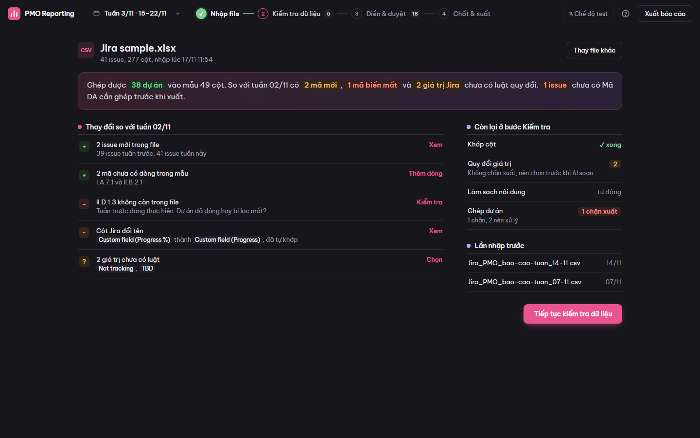

### Bước 2 · Kiểm tra dữ liệu
Gồm 4 tab con: khớp cột Jira với mẫu, quy đổi giá trị, làm sạch nội dung, ghép dự án.

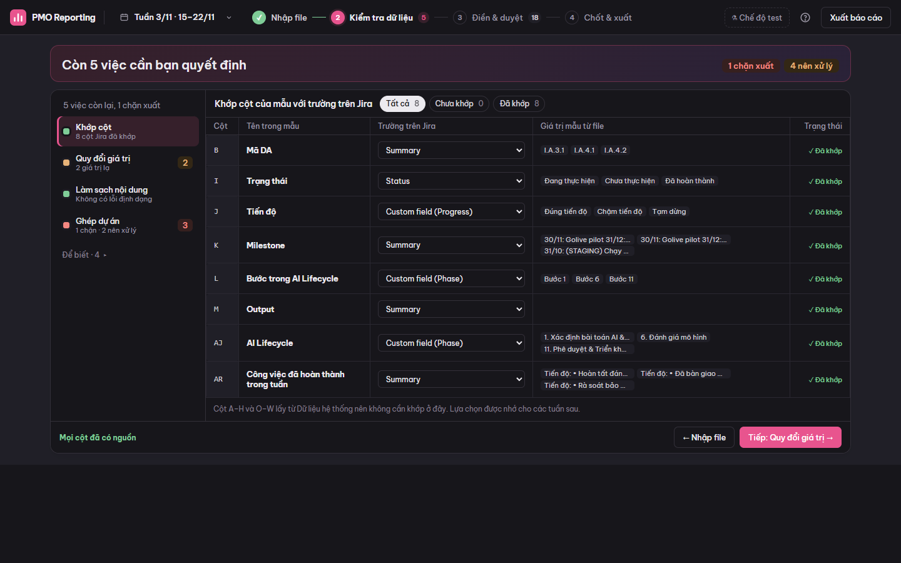
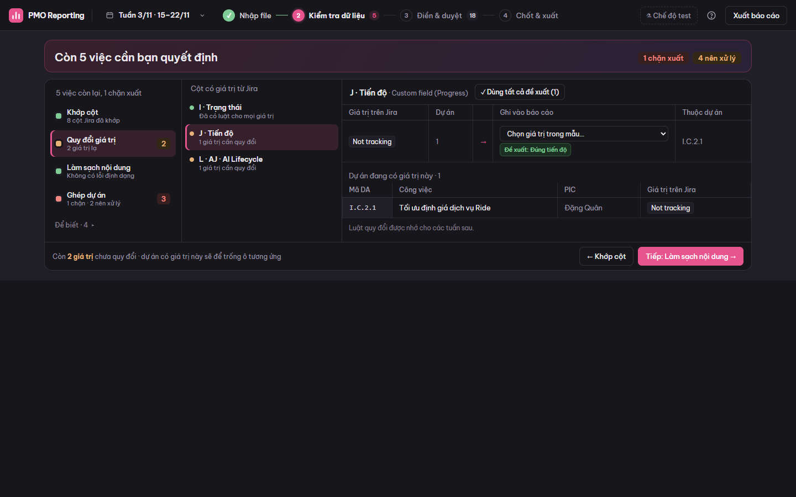
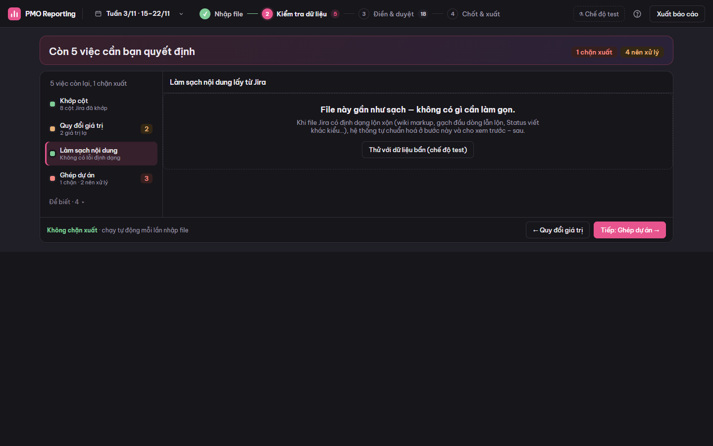
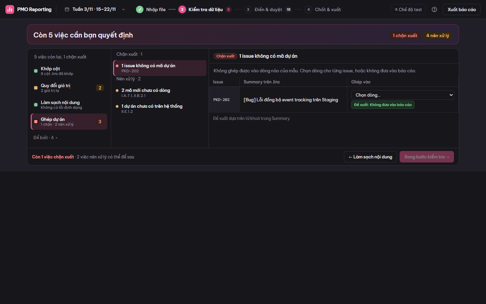

### Bước 3 · Điền & duyệt
Bảng 49 cột (sửa trực tiếp, tìm, lọc, kéo cột, menu chuột phải, duyệt nháp AI từng ô).

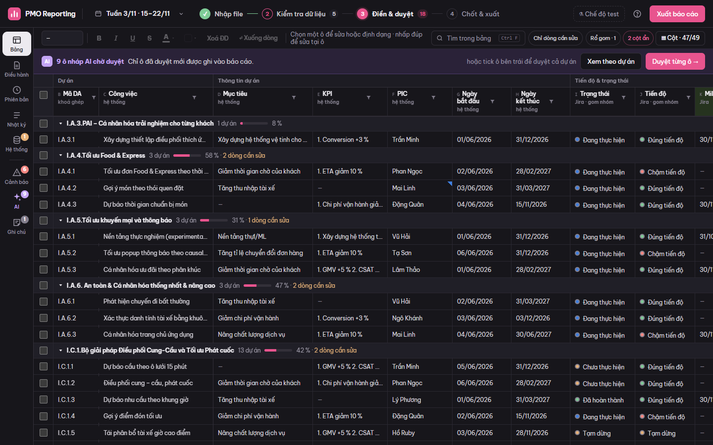

Báo cáo điều hành: xem trước như file PDF, có thể nhờ AI soạn nội dung.

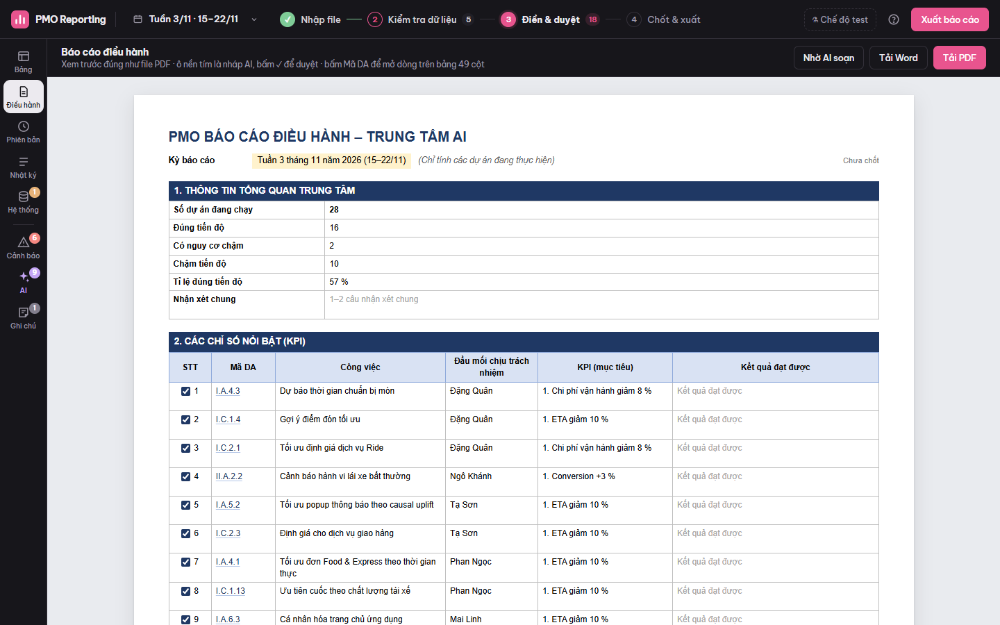

### Các màn phụ

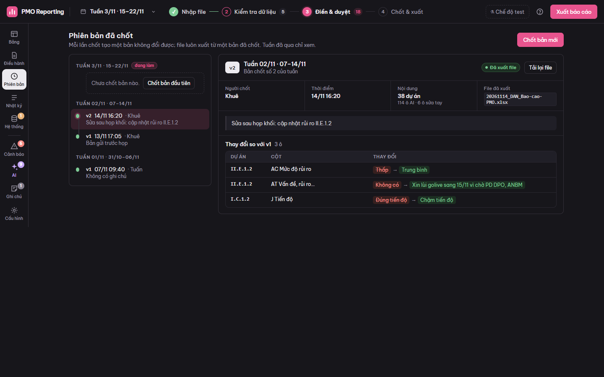
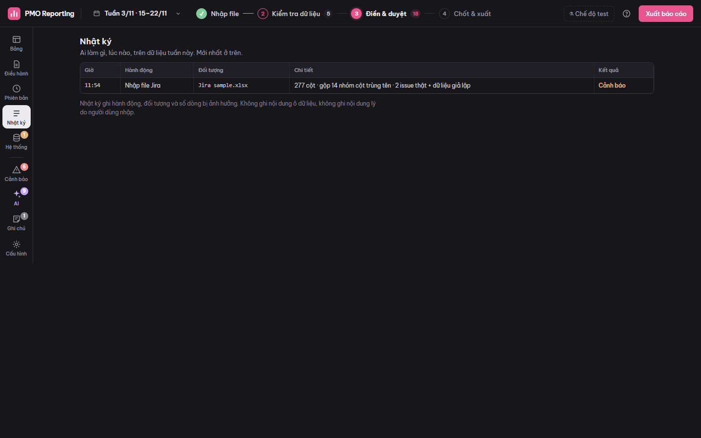
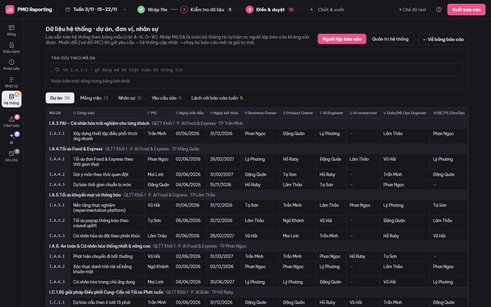
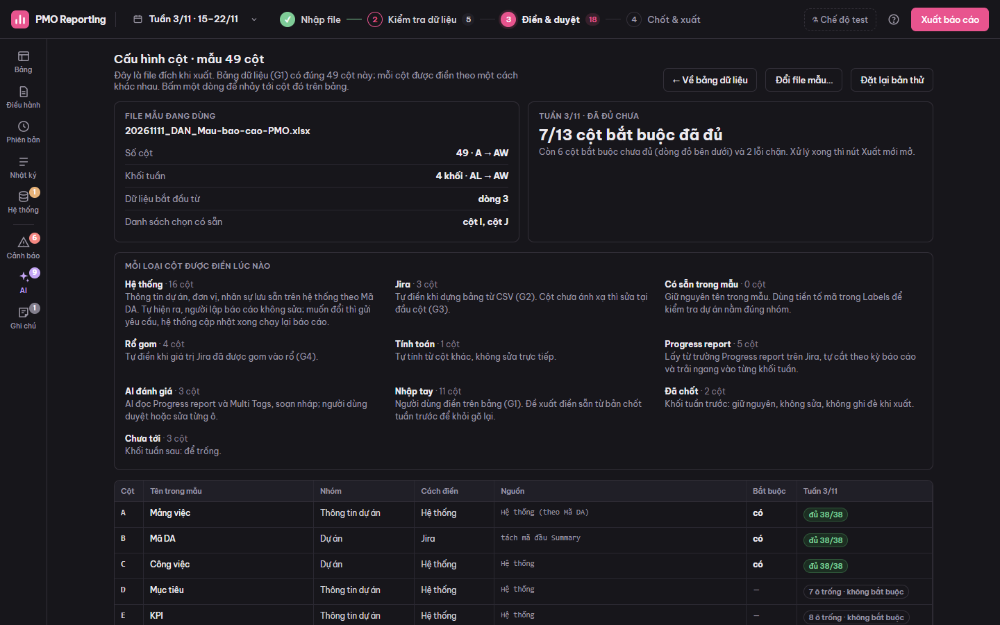

### Bước 4 · Chốt & xuất
Kiểm tra trước khi chốt, chốt thành phiên bản, rồi xuất file.

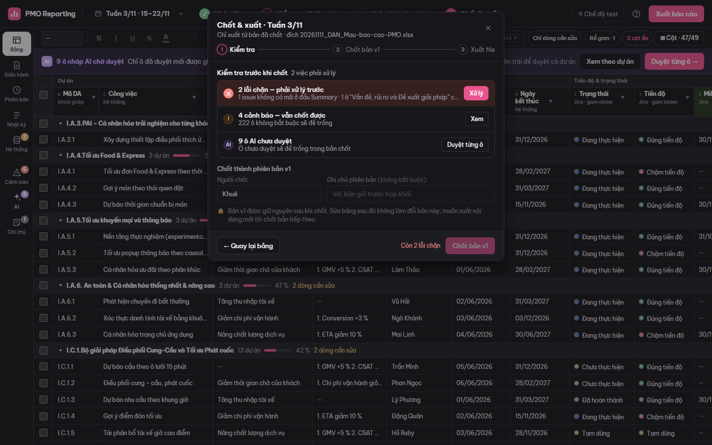

## Trạng thái và hạn chế đã biết
- Mọi dữ liệu là mock (`src/data/`). Việc nối backend sẽ làm sau, bắt đầu từ màn Nhập file.
- `useAppState()` đăng ký cả store nên vẽ lại rộng mỗi lần đổi; ổn với ~40 dòng, cần selector hẹp nếu dữ liệu lớn.
- Còn nhiều biến một chữ cái và viết tắt (`r`, `cr`, `flt`, `iss`...) chưa được đổi tên.
- Hoạt ảnh phụ của bản gốc chưa port (chuyển view, đếm số, nảy badge). "Excel theo mẫu" (.xlsx) mới ghi nhật ký, chưa tạo file.
- Console có 1 lỗi 404 tài nguyên (chưa xác định nguồn; có thể là favicon).

## Quy ước làm việc (cho PR)
- Mỗi thay đổi kèm cập nhật tài liệu: mục "Những việc đã làm" trong README này (hoặc file trong `docs/`), và chụp lại ảnh màn hình nếu giao diện đổi.
- Chạy `npm run typecheck && npm test && npm run build` trước khi mở PR.
- Tên biến/hàm/field bằng tiếng Anh; chuỗi hiển thị cho người dùng giữ tiếng Việt.
