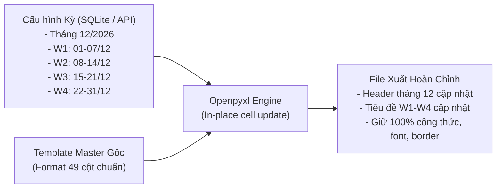

# Design Document: Modular Pipeline Backend cho PMO Reporting Agent

- **Ngày cập nhật**: 19/11/2026 (Bản hoàn thiện kiến trúc v2)
- **Trạng thái**: Chờ phê duyệt (Dự thảo kỹ thuật chi tiết)
- **Mã dự án**: DAN-FL / PMO Reporting Agent v3.1
- **Phân công trách nhiệm**:
  - `server/`: Đức (Core Backend Pipeline: FL01, FL02, FL03, FL04, FL05, FL06, FL07, FL08, FL09, FL12)
  - `ai/`: Khuê / Team AI (V-LLM, Prompt Engineering & Risk Assessment FL10 — **tách riêng thư mục độc lập**)
  - `client/`: Đã hoàn thiện prototype React, nối API với `server/`
- **Mục tiêu bàn giao**: Pilot UAT 27–30/11/2026, Nghiệm thu muộn nhất 04/12/2026

---

## 1. Mục đích & Bối cảnh (Intent & The Why)

### 1.1. Bối cảnh
PMO khối AI (VinSmart / VSF) hàng tuần phải tổng hợp báo cáo tiến độ các dự án AI sang mẫu Excel 49 cột chuẩn (`20261111_DAN_Mau-bao-cao-PMO.xlsx`). Nguồn dữ liệu hiện tại được xuất từ hệ thống Jira (dưới dạng file CSV nhiều cột, có tới 14 nhóm header trùng tên, chứa các bảng cú pháp wiki phức tạp như Progress Report, Risk Notes). 
Trước đây, việc chuyển đổi, bóc tách và đối chiếu dữ liệu được thực hiện thủ công, mất 4–8 giờ/tuần và dễ xảy ra sai sót.

Giao diện người dùng (Frontend) đã được port thành công từ prototype sang React 18 + TypeScript + Zustand, nhưng hiện tại 100% dữ liệu và logic xử lý vẫn đang chạy trên dữ liệu giả lập (mock data tại `client/src/data/`).

### 1.2. Mục đích
Xây dựng hệ thống Backend thực tế (`server/` - Python FastAPI) thay thế toàn bộ mock data, tập trung vào **Core Data Pipeline**:
1. Xử lý triệt để vòng đời upload file: nhận diện encoding, lọc file bẩn, chống nạp file trùng, so sánh diff giữa file mới và cũ, bảo toàn các ô user đã chỉnh sửa tay.
2. Hiện thực hóa chính xác 77 quy tắc mapping kỹ thuật (`Dev_Mapping_chi_tiet`) đã được PMO phê duyệt sang 49 cột chuẩn A–AW.
3. Kiến trúc template động linh hoạt: xử lý chuyển kỳ mượt mà từ Tháng 11 sang Tháng 12/2026 và các tháng tương lai mà không phụ thuộc vào việc sửa file Excel mẫu bằng tay.
4. Đóng băng phiên bản bất biến (v1, v2...) và kết xuất file Excel `.xlsx` thật giữ nguyên 100% định dạng, công thức và cấu trúc của template gốc.
5. Cung cấp API gateway/interface chuẩn để cắm nối với dịch vụ AI độc lập (`ai/`) do team AI phụ trách.

---

## 2. Mục tiêu, Giới hạn & Chống mục tiêu (Goals, Non-Goals, Anti-Goals)

### 2.1. Mục tiêu (Goals)
- **Đạt 8 tính năng Core Must của Backend theo PRD v3.1 & Function List v2.1**:
  - `FL01`: Nhập Jira CSV và chế độ Demo (chạy được với Golden Dataset 19 issues, xử lý mọi trường hợp upload bẩn/trùng/lỗi).
  - `FL02`: Ánh xạ cột vào mẫu PMO (xử lý quan hệ 1:1, 1:N, N:1 ưu tiên, N:1 gộp theo 77 quy tắc).
  - `FL04`: Ghép dự án theo mã DA chuẩn (Lựa chọn A) và phân bổ nội dung theo ranh giới tuần (4 tuần/tháng).
  - `FL05`: Quy đổi độc lập Status, Progress, và chuẩn hóa 12 bước AI Lifecycle (Phase).
  - `FL06`: Động cơ kiểm tra chất lượng dữ liệu, phát hiện lỗi chặn (`Blockers`) và cảnh báo (`Warnings`).
  - `FL07`: Dựng dữ liệu bảng 49 cột cho Frontend hiển thị mượt mà.
  - `FL08`: Rà soát, lưu nháp, ghi nhật ký audit trail và đóng băng phiên bản (`Version Lock`).
  - `FL09`: Render file Excel `.xlsx` chuẩn bằng `openpyxl` từ file template gốc, hỗ trợ tự động đổi tiêu đề tuần/tháng khi sang tháng mới.
- **Bảo toàn trải nghiệm Frontend**: Giữ độ trễ tương tác 0ms khi thao tác trên lưới 49 cột (không gửi network request mỗi khi gõ phím).
- **Kịp tiến độ UAT (27–30/11/2026)**.

### 2.2. Giới hạn & Phân tách phạm vi (Non-Goals)
- **Môi trường chạy cục bộ đơn người dùng (Single-User Local Run)**: Hệ thống chạy trên môi trường máy nội bộ cho 1 người thao tác tại một thời điểm. **Không cần xử lý tranh chấp phiên nhiều người (concurrency / race condition) hay phân quyền đăng ký/đăng nhập phức tạp** ở giai đoạn này. Khi mở rộng sau này, cơ chế tài khoản riêng (của ai chỉ thấy của người đó) sẽ được tích hợp sau.
- **Phần AI (FL10)**: Tách hoàn toàn ra khỏi phạm vi triển khai của `server/`. Phần mô hình V-LLM, prompt engineering, fine-tuning và ma trận chấm điểm rủi ro do `Khuê / Team AI` phụ trách độc lập tại thư mục `ai/`. `server/` chỉ cung cấp contract interface/proxy đơn giản để gọi sang khi cần.
- Không kết nối trực tiếp Jira REST API trong đợt Pilot (thuộc giai đoạn 2; pilot ưu tiên nạp file CSV export).
- Không triển khai Hub dữ liệu tổng hợp (`FL11`) và Báo cáo tiến độ AI Lifecycle riêng biệt (`AC07.5, UAT15`).
- Không ghi ngược dữ liệu về Jira và không tự động gửi email báo cáo.

### 2.3. Chống mục tiêu (Anti-Goals)
- **Không biến Backend thành monolith cồng kềnh**: Tránh việc mỗi thao tác gõ 1 ký tự trên lưới của client phải round-trip lên server gây lag.
- **Không làm hỏng file mẫu Excel**: Tuyệt đối không dùng các thư viện tạo file mới từ đầu làm mất macro, data validation dropdown, công thức ẩn hoặc conditional formatting của file gốc `20261111_DAN_Mau-bao-cao-PMO.xlsx`.
- **Không hardcode cứng tháng 11**: Thiết kế template engine phải sống được qua tháng 12/2026, tháng 01/2027 mà không phải đập đi sửa lại code.

---

## 3. Ràng buộc kỹ thuật & Nghiệp vụ (Constraints)

1. **Thời gian**: Mốc bàn giao bản tích hợp để PMO dùng thử là 25–26/11; bắt đầu UAT từ 27/11/2026 (còn khoảng 7–8 ngày làm việc).
2. **Công nghệ Server**: Python 3.11+, framework FastAPI, Uvicorn (chạy cổng 8000, Vite client proxy qua `/api`).
3. **Lưu trữ**: SQLite database gọn nhẹ cho giai đoạn pilot (lưu snapshot JSON và audit logs), lưu file trên disk cục bộ.
4. **Tách biệt dịch vụ**: `server/` độc lập với `ai/` và `client/`.
5. **Định dạng bảng tính**: Sử dụng `openpyxl` với cờ `keep_vba=True` để nhân bản template và điền dữ liệu an toàn.

---

## 4. Xử lý Toàn diện Vòng đời & Các Ca Ngoại lệ của Upload File (FL01, FL06)

Quá trình tiếp nhận file từ Jira tiềm ẩn rất nhiều rủi ro dữ liệu bẩn. Backend xây dựng một quy trình 6 bước chặt chẽ:

```
[File Upload] ──> (1. Format & Encoding) ──> (2. Hash & Fingerprint) ──> (3. File Storage)
                                                                               │
[User Confirm] <── (5. Diffing Engine) <── (4. Ingestion & Validation) <───────┘
       │
       └──> (6. Build Working Session State)
```

### 4.1. Kiểm tra Định dạng & Bảng mã (Format & Encoding Validation)
- **Đuôi file hợp lệ**: `.csv`, `.tsv`, `.txt`, `.xlsx`, `.xlsm`, `.xls`. Nếu sai định dạng $\rightarrow$ trả về lỗi ngay lập tức `E_FILE_UNSUPPORTED_FORMAT`.
- **Tự động nhận diện Encoding**: File CSV xuất từ Jira thường có UTF-8 BOM (`\ufeff`), UTF-8 tiêu chuẩn, UTF-16, hoặc Windows-1258 (tiếng Việt cũ). Backend sử dụng thư viện `charset-normalizer` để tự động phát hiện và giải mã an toàn, loại bỏ BOM.
- **Phân tách cột (Delimiter)**: Tự động phát hiện dấu phẩy `,`, dấu chấm phẩy `;` hoặc tab `\t`.
- **Dòng trống & Ô lỗi**: Bỏ qua các dòng trống hoàn toàn (ví dụ dòng 4 của Jira sample rỗng cả 277 cột) và ghi log số lượng dòng rác bị loại bỏ.
- **Kiểm tra cấu trúc tối thiểu**: Bắt buộc phải có 2 cột gốc: `Summary` và `Issue key` (hoặc `Key`). Nếu thiếu một trong hai $\rightarrow$ trả về lỗi chặn `E_FILE_INVALID_SCHEMA` và từ chối dựng bảng.

### 4.2. Phát hiện File Trùng & Vân tay Tệp (Deduplication / Fingerprinting - AC01.3)
- Mỗi file tải lên được tính toán mã băm `SHA256`.
- Backend kiểm tra trong bảng `uploaded_files` của SQLite:
  - Nếu mã SHA256 đã tồn tại trong cùng kỳ báo cáo (`cycle_id`):
    - Trả về cảnh báo: `"File này đã được nạp trước đó vào lúc [HH:mm dd/MM] bởi [User]"`.
    - Cung cấp cờ `force_reload`: Nếu `false`, trả về dữ liệu phiên đã parse trước đó mà không nạp trùng bản ghi; nếu `true`, thực hiện parse lại toàn bộ.

### 4.3. Chiến lược Lưu trữ File (Storage & Retention)
- File gốc được lưu trữ tại đường dẫn an toàn trên server:
  `server/storage/uploads/{cycle_id}/{YYYYMMDD_HHmmss}_{sha256[:8]}_{safe_filename}`
- Bảng SQLite `uploaded_files` quản lý:
  - `id`: Khóa chính
  - `cycle_id`: Chu kỳ báo cáo (vd `2026_11_w3`)
  - `original_name`: Tên file gốc
  - `stored_path`: Đường dẫn vật lý trên đĩa
  - `sha256`: Mã băm
  - `row_count`, `col_count`: Số dòng/cột đọc được
  - `status`: `parsed`, `applied`, `superseded`, `failed`
  - `uploaded_at`, `uploaded_by`: Người và thời gian tải lên

### 4.4. Động cơ So sánh File Mới / Cũ (Diff Engine - AC01.4, AC08.5)
Khi người dùng tải lên file Jira mới trong cùng một kỳ báo cáo (đã có lần nạp trước):
- Backend so sánh danh sách `Issue key` và `Mã DA` giữa file mới và phiên hiện tại:
  1. `added_projects`: Các dự án/issue mới xuất hiện trong file mới.
  2. `removed_projects`: Các dự án có trong lần nạp trước nhưng lần này biến mất khỏi file Jira.
  3. `modified_fields`: Các trường dữ liệu bị thay đổi trên Jira (ví dụ: Jira vừa đổi Status từ `In Progress` sang `Done`, hoặc có thêm dòng Progress Report mới).
  4. `schema_diff`: Xuất hiện cột Jira mới hoặc mất cột Jira cũ so với cấu hình mapping.
- **Nguyên tắc bảo toàn dữ liệu chỉnh sửa tay (Override Preservation)**:
  - Các ô người dùng đã chỉnh sửa thủ công (`overrides`) trên lưới 49 cột ở các dự án không đổi sẽ **được giữ nguyên vẹn**, không bị ghi đè bởi file mới.
  - Những ô mà dữ liệu Jira nguồn vừa thay đổi sẽ được đánh dấu cờ `needs_review: true` để người dùng rà soát lại.
- Trả về cấu trúc `DiffSummary` để Frontend hiển thị hộp thoại xác nhận trước khi áp dụng.

### 4.5. Cơ chế Hủy & Thay thế File An toàn (Rollback / Cancel)
- Nếu việc parse file mới gặp lỗi hoặc người dùng bấm nút "Huỷ, chọn file khác" trong lúc đang xem preview, Backend giữ nguyên trạng thái làm việc của lần nạp thành công trước đó, không xóa trắng session.

---

## 5. Kiến trúc Template Động & Xử lý Chuyển tiếp Tháng (Multi-Month / Rolling Cycles)

### 5.1. Vấn đề Thực tế
File template gốc `20261111_DAN_Mau-bao-cao-PMO.xlsx` hiện đang có tiêu đề cố định:
- Dòng 1 ghi: `Báo cáo tháng 11`
- Khối 4 tuần ở các cột `AL–AW` ghi cố định các ngày của Tháng 11/2026:
  - `AL–AN`: `Tuần 01/11 (từ 31/10 - 6/11/2026)`
  - `AO–AQ`: `Tuần 02/11 (từ07/10 - 14/11/2026)`
  - `AR–AT`: `Tuần 3/11 (từ 15/11 -22/11/2026)`
  - `AU–AW`: `Tuần 03/11 (từ 23/11 - 30/11/2026)`

Khi hệ thống bước sang **Tháng 12/2026**, nếu backend hardcode thì sẽ làm vỡ báo cáo.

### 5.2. Giải pháp: Cấu hình Kỳ Động & Header Rewriting trong Openpyxl



1. **Quản lý Chu kỳ và Ranh giới Tuần trong Database (`cycle_weeks`)**:
   - Mỗi chu kỳ báo cáo tháng có định nghĩa 4 khối tuần độc lập:
     - **Tháng 11/2026 (`cycle_2026_11`)**: W1 (31/10–06/11), W2 (07/11–14/11), W3 (15/11–22/11), W4 (23/11–30/11).
     - **Tháng 12/2026 (`cycle_2026_12`)**: W1 (01/12–07/12), W2 (08/12–14/12), W3 (15/12–21/12), W4 (22/12–31/12).
     - **Tháng 01/2027 (`cycle_2027_01`)**: W1 (01/01–07/01), ...
   - Bộ bóc tách `wiki_parser.py` sử dụng chính cấu hình ngày này để lọc các mốc `|{{YYYY-MM-DD}}|` trong Progress Report đổ vào đúng 4 khối tuần `AL–AN`, `AO–AQ`, `AR–AT`, `AU–AW`.
2. **Cập nhật Tiêu đề Động trong Openpyxl (`excel_builder.py`)**:
   - Khi render file Excel:
     - Ô tiêu đề tháng (nếu có): Tự động ghi chuỗi định dạng theo kỳ, ví dụ `BÁO CÁO TIẾN ĐỘ THÁNG 12/2026`.
     - Dòng 1 tại 4 khối tuần được tự động cập nhật:
       - Cột AL1: `Tuần 01/{MM} (từ {W1.start} - {W1.end})`
       - Cột AO1: `Tuần 02/{MM} (từ {W2.start} - {W2.end})`
       - Cột AR1: `Tuần 03/{MM} (từ {W3.start} - {W3.end})`
       - Cột AU1: `Tuần 04/{MM} (từ {W4.start} - {W4.end})`
     - Không thay đổi cấu trúc merged cells hay styles của tiêu đề.
3. **Cơ chế Template Override**:
   - Nếu PMO sau này cung cấp file mẫu riêng cho từng tháng (ví dụ `storage/templates/template_2026_12.xlsx`), hệ thống tự động kiểm tra: nếu có file template riêng cho tháng đó thì ưu tiên dùng, nếu không có thì dùng template mặc định và kích hoạt cơ chế Dynamic Header Rewriting.

---

## 6. Kiến trúc Thư mục Tổng thể (Tách rời AI)

Hệ thống được tổ chức thành 3 thư mục độc lập ở cấp cao nhất của repository:

```
AI-Reporting-Agent/
├── client/                     # FRONTEND (React 18 + Vite + Zustand) - Giữ nguyên
├── server/                     # CORE BACKEND PIPELINE (FastAPI + openpyxl + SQLite) - Phạm vi của chúng ta
└── ai/                         # AI & V-LLM SERVICE - Tách độc lập, do Khuê / Team AI phụ trách
```

### 6.1. Chi tiết Thư mục Backend (`server/`)

```
server/
├── pyproject.toml              # Dependencies: fastapi, uvicorn, openpyxl, pandas, charset-normalizer, pydantic
├── requirements.txt            # Frozen dependencies
├── README.md                   # Hướng dẫn chạy backend
├── .env.example                # Cấu hình cổng, đường dẫn storage, AI_SERVICE_URL
├── storage/                    # Thư mục lưu trữ tệp cục bộ
│   ├── uploads/                # File CSV người dùng tải lên (phân cấp theo cycle_id)
│   ├── templates/              # File mẫu Excel gốc PMO (20261111_DAN_Mau-bao-cao-PMO.xlsx)
│   ├── fixtures/               # Golden Dataset CSV (19 issues) để chạy test tự động
│   ├── exports/                # File Excel kết xuất ra
│   └── pmo_reporting.db        # SQLite database
│
├── app/
│   ├── main.py                 # FastAPI application entry point, CORS, prefix /api/v1
│   │
│   ├── core/                   # Cấu hình cốt lõi
│   │   ├── config.py           # BaseSettings (.env), đường dẫn thư mục
│   │   ├── database.py         # SQLite connection, sessionmaker
│   │   └── security.py         # Session verification
│   │
│   ├── models/                 # SQLAlchemy ORM Models
│   │   ├── cycle.py            # ReportingCycle (tuần, tháng, ranh giới ngày)
│   │   ├── file.py             # UploadedFile (sha256, path, status, row_count)
│   │   ├── version.py          # ReportVersion (snapshot bất biến v1, v2)
│   │   ├── catalog.py          # MasterCatalog (68 mã DA chuẩn, phòng ban)
│   │   └── audit.py            # AuditLog (nhật ký sửa ô, thời gian, user)
│   │
│   ├── schemas/                # Pydantic Schemas (API Contracts)
│   │   ├── common.py           # Standard APIResponse, ErrorResponse
│   │   ├── row.py              # Schema Row 49 cột (khớp 100% với client types/index.ts)
│   │   ├── ingest.py           # UploadResponse, DiffSummary, FileStats, Blockers, Warnings
│   │   ├── cycle.py            # CycleSchema, WeekBoundarySchema
│   │   └── export.py           # LockRequest, ExportExcelRequest
│   │
│   └── modules/                # 3 Module Nghiệp vụ Chính
│       ├── ingestion/          # MODULE 1: INGESTION & QUALITY CONTROL (FL01, FL06)
│       │   ├── router.py       # POST /api/v1/ingest/upload, /demo, /diff
│       │   ├── file_handler.py # Lưu file, hash SHA256, kiểm tra encoding & format
│       │   ├── diff_engine.py  # So sánh file mới vs phiên cũ, bảo toàn override
│       │   └── validator.py    # Kiểm tra Blockers (E_NO_CODE, E_REQUIRED) & Warnings
│       │
│       ├── mapping/            # MODULE 2: 77 MAPPING RULES & NORMALIZATION (FL02, FL04, FL05)
│       │   ├── router.py       # POST /api/v1/mapping/recalculate
│       │   ├── csv_cleaner.py  # Giải quyết 14 nhóm header trùng tên, alias
│       │   ├── wiki_parser.py  # Bóc tách bảng wiki Progress Report & Risk Notes theo ngày
│       │   ├── rule_engine.py  # Hiện thực hóa 77 quy tắc kỹ thuật từ Dev_Mapping_chi_tiet
│       │   ├── reconciler.py   # Ghép mã DA (Lựa chọn A), gom orphan issues
│       │   └── normalizer.py   # Quy đổi Status, Progress, 12 bước AI Lifecycle
│       │
│       └── reporting/          # MODULE 3: VERSIONING & OPENPYXL EXPORT (FL08, FL09)
│           ├── router.py       # POST /api/v1/reports/lock, GET /api/v1/reports/export-excel
│           ├── snapshot.py     # Đóng băng dữ liệu thành JSON snapshot bất biến
│           ├── cycle_mgr.py    # Quản lý chu kỳ tuần, chuyển tiếp tháng 11 -> tháng 12
│           └── excel_builder.py# Openpyxl: in-place update 68 dòng, dynamic header W1-W4
│
└── tests/                      # Bộ kiểm thử tự động (Pytest)
    ├── test_file_upload.py     # Test file bẩn, BOM, file trùng hash, thiếu cột
    ├── test_diff_engine.py     # Test so sánh file mới/cũ, bảo toàn overrides
    ├── test_mapping_golden.py  # Chạy 77 quy tắc đối chiếu với 19 issues Golden Dataset
    ├── test_multi_month.py     # Test chuyển kỳ từ tháng 11 sang tháng 12
    └── test_excel_export.py    # Test xuất file Excel mở được trên Desktop
```

### 6.2. Thư mục AI Độc lập (`ai/`)
- Nằm ngang hàng với `server/`.
- Chứa toàn bộ service V-LLM, prompt templates, few-shot examples và risk scoring engine do team AI phát triển.
- `server/` chỉ lưu cấu hình `AI_SERVICE_URL=http://localhost:8001/api/v1` trong file `.env` và cung cấp proxy endpoint nếu frontend cần gọi xuyên qua server.

---

## 7. Chi tiết Triển khai Kỹ thuật cho Backend

### 7.1. Hiện thực 77 Quy tắc Mapping Kỹ thuật (`rule_engine.py`)
Mọi quy tắc trong sheet `Dev_Mapping_chi_tiet` được ánh xạ thành code Python:
- **Cột Ghim (Pin)**:
  - Cột B (`Mã DA`): Regex `^\s*([IVX]+\.[A-Z0-9]+(?:\.[0-9]+)+)\s+(.*)$` lấy nhóm 1.
  - Cột C (`Công việc`): Nhóm 2 của regex trên.
- **Cột Thông tin (Info)**:
  - Cột A (`Mảng việc`): Khởi tạo từ mảng việc theo dòng mẫu (hoặc Master Catalog).
  - Cột D (`Mục tiêu`): Text trước `MILESTONES?` trong Description. Fallback sang `Custom field (Goals)`.
  - Cột E (`KPI`): Parse bảng wiki trong `Custom field (KPI/Outcome)`.
  - Cột F (`PIC`): Ưu tiên `Assignee`, fallback sang `Custom field (PO)` hoặc `Custom field (Tech lead)`.
  - Cột G, H (`Bắt đầu, Kết thúc`): `Custom field (Start date)` và `Due date`.
- **Cột Tiến độ & Trạng thái (Prog)**:
  - Cột I (`Trạng thái`): Tra bảng `STATUS_MAP`.
  - Cột J (`Tiến độ`): Tra bảng `PROGRESS_MAP`.
  - Cột K (`Milestone`): Các dòng `{{YYYY-MM-DD}}` sau `MILESTONE:`.
  - Cột L (`Bước AI Lifecycle`): Lấy số đầu của Phase $\rightarrow$ đối chiếu 12 bước AI Lifecycle.
- **Cột Đánh giá (Eval)**:
  - Cột AA (`TRẠNG THÁI 1`): Tự động tính `= Trạng thái + " " + Tiến độ`.
  - Cột AF (`Loại dự án`): Mặc định `KHHĐ 2026`.
  - Cột AI (`Market`): Tách từ `Custom field (Location/Department)` $\rightarrow$ `VN`.
- **Nội dung theo 4 khối tuần (`AL–AW`)**:
  - Tách từ bảng wiki `Progress Report` theo ngày, đối chiếu với ranh giới của 4 tuần trong kỳ để đổ vào:
    - Hoàn thành: Cột `AL` (W1), `AO` (W2), `AR` (W3), `AU` (W4).
    - Kế hoạch: Cột `AM` (W1), `AP` (W2), `AS` (W3), `AV` (W4).
    - Vấn đề/Rủi ro: Bóc tách đoạn sau `# *Blockers:*` hoặc `Risk:` đưa vào `AN` (W1), `AQ` (W2), `AT` (W3), `AW` (W4).

### 7.2. Quy tắc Ghép Dự án (Lựa chọn A - Đã chốt)
- Mỗi dòng bảng 49 cột tương ứng với **1 ticket chính mang Mã DA ở đầu Summary** (thường là Epic dự án).
- Toàn bộ dữ liệu tiến độ, trạng thái, milestone lấy trực tiếp từ ticket chính này.
- Các task/subtask con (liên kết qua `Parent key`) được lưu vào thuộc tính `subtasks` của dòng để phục vụ truy vết (Audit Trail), **không cộng dồn làm đổi trạng thái của ticket cha**.
- Các issue mồ côi (không có mã hoặc mã không thuộc danh mục) được trả về trong mảng `orphans` để người dùng rà soát ở tab Ghép dự án.

### 7.3. Động cơ Openpyxl Xuất Báo cáo Chuẩn (`excel_builder.py`)
1. Mở file template gốc `storage/templates/20261111_DAN_Mau-bao-cao-PMO.xlsx` với `openpyxl.load_workbook(..., keep_vba=True)`.
2. Kiểm tra chu kỳ báo cáo:
   - Nếu là Tháng 12/2026: Tự động ghi đè tiêu đề dòng 1 tại các cột `AL1`, `AO1`, `AR1`, `AU1` với ngày của Tháng 12.
3. Duyệt snapshot phiên bản đã chốt:
   - Với mỗi dòng dự án: Tìm hàng có Mã DA khớp tại Cột B (trong 68 dòng có sẵn).
   - Ghi giá trị hiệu lực vào các ô từ A đến AW.
   - Giữ nguyên ô công thức (như Cột AA) và cột trống X.
4. Lưu workbook ra `storage/exports/20261121_DAN_Bao-cao-PMO_v{N}.xlsx` và stream file binary về client.

### 7.4. Làm sạch Dữ liệu Jira & Xử lý Text Rác (`text_sanitizer.py`)
1. **Loại bỏ Jira Markup & Thẻ HTML**:
   - Tự động bóc tách các thẻ màu `{color:red}...{color}` $\rightarrow$ giữ lại text thuần.
   - Loại bỏ các thẻ định dạng wiki: `*bold*`, `_italic_`, `+underline+`, `-strikethrough-`.
   - Bóc tách macro link: `[https://xanhsm...|smart-link]` $\rightarrow$ URL ngắn gọn hoặc text tiêu đề `[LADP-465]`.
   - Lọc bỏ Java Object text không xác định: ví dụ `ApprovalsCFValue{approvals=[]}` $\rightarrow$ chuỗi rỗng.
2. **Bảo toàn Ký tự Xuống dòng trong Ô Text Dài**:
   - Chuẩn hóa ký tự xuống dòng `\r\n` $\rightarrow$ `\n`.
   - Không làm mất đoạn văn khi tách bullet points trong Progress Report và Milestone.
3. **Chuẩn hóa Định dạng Ngày tháng Đa dạng**:
   - Trường ngày hệ thống Jira (`Created`, `Due date`, `Start date`): Parse theo `%m/%d/%Y %H:%M` hoặc `%d/%b/%y %I:%M %p`.
   - Text ngày trong milestone / bảng wiki: Parse theo chuẩn ISO `%Y-%m-%d`.
   - Luôn xuất ra kiểu `datetime.date` chuẩn để Excel hiển thị thống nhất dạng `dd/mm/yyyy`.

### 7.5. Động cơ Kiểm tra Mâu thuẫn Logic & Cảnh báo Chéo (`cross_validator.py`)
1. **Phát hiện Mâu thuẫn Tiến độ (`W_PROGRESS_CONFLICT` - AC06.3)**:
   - Nếu trường `Tiến độ (J)` ghi nhận là **`Đúng tiến độ`** (từ `On-track`), nhưng:
     - Trong đoạn văn `Progress Report` hoặc `Risk Notes` có chứa các từ khóa rủi ro/trễ hạn: `blocker`, `lùi lịch`, `chậm`, `delay`, `hoãn`, `vướng`, `vỡ SLA`.
     - HOẶC ngày `Due date (H)` đã nhỏ hơn ngày hiện tại của kỳ báo cáo.
   - $\rightarrow$ Tự động gắn cảnh báo vàng `W_PROGRESS_CONFLICT` để PMO kiểm tra lại, không để lọt "báo cáo ảo".
2. **Xử lý Trạng thái & Tiến độ Lạ (`W_UNMAPPED_VALUE`)**:
   - Nếu gặp các giá trị Jira chưa có trong bảng quy đổi (ví dụ: Status `Monitoring`, `Cancled` do gõ sai):
     - Tuyệt đối **không tự ý gán bừa**.
     - Giữ nguyên giá trị gốc, hiển thị cảnh báo `W_UNMAPPED_VALUE` tại bước Kiểm tra dữ liệu để người dùng chủ động chọn nhóm quy đổi.

### 7.6. Đảm bảo Độ Toàn vẹn của Template Excel (`excel_styler.py`)
1. **Bảo toàn Tuyệt đối Data Validation Dropdowns**:
   - Giữ nguyên các dropdown list có sẵn trong template gốc (Trạng thái ở Cột I, Tiến độ ở Cột J, Giá trị ở Cột AB, Market ở Cột AI).
   - Ghi đè trực tiếp giá trị vào thuộc tính `cell.value`, không chạm vào cấu hình `ws.data_validations`.
2. **Tự động Xuống dòng & Căn chỉnh Ô (Wrap Text & Vertical Alignment)**:
   - Các cột nội dung dài (D Mục tiêu, E KPI, K Milestone, AL–AW Nội dung tuần) được tự động set:
     `cell.alignment = Alignment(wrap_text=True, vertical='top')`
     Giúp người dùng mở file Excel trên máy tính là đọc được ngay, không bị tràn hay cắt chữ.
3. **Ghi Đúng Kiểu Dữ liệu Gốc (Native Data Types)**:
   - Ngày tháng ghi dạng `datetime.date` (không ghi text string).
   - Số liệu ghi dạng `int` hoặc `float` (không ghi text).
   - Giữ nguyên công thức ghép chuỗi tại Cột AA `TRẠNG THÁI 1`.

### 7.7. Xử lý Ranh giới Tuần Đặc biệt & Dự án Vắt qua Năm
1. **Tháng có 5 Tuần Báo cáo**:
   - Cấu hình `cycle_weeks` hỗ trợ linh hoạt 4 hoặc 5 tuần.
   - Theo chuẩn quy ước PMO (PRD §5.5): Nếu tháng có 5 tuần mà template chỉ có 4 khối (A–AW), hệ thống tự động gộp các ngày cuối tháng vào Khối tuần 4 (W4 kéo dài 8–9 ngày), đảm bảo không bỏ sót ngày nào.
2. **Dự án Vắt qua Năm (Year Rollover: 2026 $\rightarrow$ 2027)**:
   - Toàn bộ thuật toán so sánh ngày tháng luôn sử dụng năm 4 chữ số (`YYYY`) để tính toán chính xác số ngày đến hạn (`daysToDue`), tránh lỗi tính sai thời hạn khi chuyển giao năm.

---

## 8. Đặc tả Hợp đồng API (API Contracts)

### 8.1. Nhóm Ingestion & Upload (`/api/v1/ingest`)
- `POST /api/v1/ingest/upload`:
  - **Input**: `file` (multipart), `cycle_id` (string), `force_reload` (boolean, default=false).
  - **Xử lý**: Kiểm tra format, encoding, tính SHA256, phát hiện file trùng, parse CSV, chạy 77 rules, so sánh diff với session cũ (nếu có).
  - **Output**:
    ```json
    {
      "success": true,
      "session_id": "sess_20261119_abc123",
      "is_duplicate_file": false,
      "file_stats": { "total_rows": 19, "total_cols": 88, "skipped_empty_rows": 1, "matched_projects": 4 },
      "diff_summary": {
        "has_previous_session": true,
        "added_projects": ["I.C.1.2"],
        "removed_projects": [],
        "modified_count": 2,
        "schema_changes": []
      },
      "rows": [ ... mảng 49 cột Row[] chuẩn ... ],
      "orphans": [ { "key": "PMOGOLD-18", "summary": "IV.Z.99.99 Kiểm mã ngoài mẫu..." } ],
      "blockers": [ { "code": "E_NO_CODE", "message": "1 issue không có mã ở đầu Summary", "key": "PKD-202" } ],
      "warnings": [ { "code": "W_UNMAPPED_VALUE", "message": "Status 'Monitoring' chưa được quy đổi", "key": "PMOGOLD-14" } ]
    }
    ```
- `POST /api/v1/ingest/demo`:
  - **Input**: `{ "cycle_id": "2026_11_w3" }`.
  - **Output**: Nạp ngay lập tức dữ liệu chuẩn đã xử lý từ file Golden Dataset 19 issues.

### 8.2. Nhóm Chu kỳ Báo cáo (`/api/v1/cycles`)
- `GET /api/v1/cycles`: Lấy danh sách các kỳ báo cáo (Tháng 11, Tháng 12, trạng thái active/locked).
- `POST /api/v1/cycles/switch`: Đổi kỳ active, trả về cấu hình 4 khối tuần tương ứng (`W1–W4`).

### 8.3. Nhóm Version & Xuất Excel (`/api/v1/reports`)
- `POST /api/v1/reports/validate-lock`:
  - **Input**: `{ "cycle_id": "2026_11_w3", "rows": [ ... ] }`.
  - **Output**: `{ "can_lock": true, "blockers_count": 0, "warnings_count": 4 }`.
- `POST /api/v1/reports/lock`:
  - **Input**: `{ "cycle_id": "2026_11_w3", "lock_by": "Khuê", "note": "Chốt tuần 3 gửi họp khối", "rows": [ ... ] }`.
  - **Output**: `{ "version_id": "ver_w3_v1", "version_no": 1, "locked_at": "2026-11-19T10:45:00Z" }`.
- `GET /api/v1/reports/export-excel`:
  - **Params**: `?version_id=ver_w3_v1`.
  - **Output**: File binary stream `application/vnd.openxmlformats-officedocument.spreadsheetml.sheet`.

---

## 9. Lộ trình Triển khai Chi tiết theo Ngày (Gantt Plan)

Vì đã **tách phần AI ra ngoài**, phạm vi của chúng ta tập trung 100% vào Core Backend Pipeline, giảm bớt áp lực và tăng độ tin cậy hoàn thành trước 25/11:

| Ngày | Hạng mục Backend (`server/`) | Hạng mục Frontend Tương ứng | Ca Kiểm thử (UAT) |
|---|---|---|---|
| **19/11 (Hôm nay)** | Khởi tạo repo `server/`, dựng FastAPI app skeleton, setup SQLite & models | Thêm `client/src/services/api.ts` | Khởi động dự án |
| **20–21/11 (2 ngày)** | **Module 1 (Ingestion)**: Xử lý encoding, SHA256 deduplication, Diff engine so sánh file mới/cũ, phát hiện lỗi chặn/cảnh báo. | Nối nút upload file và preview so sánh file mới/cũ | `UAT01, UAT02, UAT10` |
| **22–23/11 (2 ngày)** | **Module 2 (Mapping)**: Bóc tách bảng wiki Progress Report & Risk Notes, chạy 77 rules theo Lựa chọn A, quy đổi Status/Progress/Phase. | Nối tab Khớp cột & Quy đổi giá trị | `UAT03, UAT04, UAT05` |
| **24/11 (1 ngày)** | **Module 3 (Export & Multi-month)**: Quản lý chu kỳ tuần, chuyển tháng 11 $\rightarrow$ tháng 12, openpyxl in-place update & dynamic headers. | Nối modal Xuất báo cáo tải file `.xlsx` thật | `UAT06, UAT09` |
| **25/11 (1 ngày)** | Tích hợp toàn diện E2E, chạy đối chiếu tự động với 19 issues Golden Dataset, fix edge cases | Kiểm tra luồng mượt mà, sẵn sàng bàn giao thử nghiệm | Đạt toàn bộ UAT Must |
| **26/11** | Bàn giao bản tích hợp cho PMO dùng thử | Hỗ trợ hướng dẫn người dùng | Chuẩn bị UAT |
| **27–30/11** | **UAT Pilot chính thức với PMO** | Fix bug phát sinh trong UAT | Nghiệm thu |

---

## 10. Những điểm giao cho Người lập trình (What's left to the builder)

1. **Ngưỡng dung lượng file tải lên**: Mặc định giới hạn file upload tối đa là 50MB (đủ cho file Jira CSV hàng chục nghìn dòng).
2. **Cấu hình AI Proxy Endpoint**: Khai báo biến môi trường `AI_SERVICE_URL` trong `.env`. Khi nào team AI hoàn thành service ở thư mục `ai/`, builder chỉ cần cấu hình URL để thông luồng, không cần viết lại logic ở server.
3. **Cơ chế cache template openpyxl**: Khi đọc file template gốc `20261111_DAN_Mau-bao-cao-PMO.xlsx`, khuyến nghị builder cache cấu hình style và địa chỉ ô vào bộ nhớ để tối ưu tốc độ xuất file dưới 3 giây.
